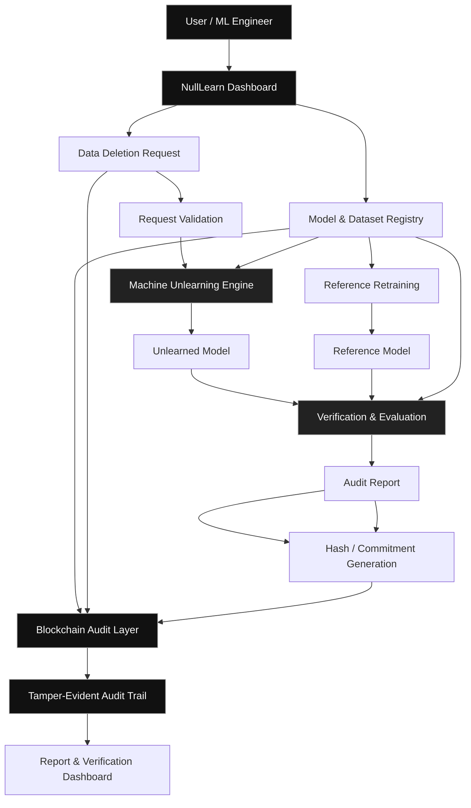

# NullLearn
### A Blockchain-Based Machine Unlearning Verification System

NullLearn is a machine learning and blockchain-based project that explores how trained machine learning models can respond to data deletion requests. It focuses on **machine unlearning**—the process of reducing the influence of specific training data on an already-trained model—and maintaining a tamper-evident audit trail of the unlearning process.

Built as a class project for **Fundamentals of Machine Learning**, NullLearn combines machine learning evaluation techniques with blockchain-based audit records to make unlearning operations more transparent, traceable, and easier to assess.

## Problem Statement

Traditional machine learning models learn patterns from training datasets. When a user requests the deletion of their data, removing the corresponding record from the original dataset does not automatically remove its influence from a model that has already been trained.

Retraining the entire model without the deleted data can be computationally expensive, especially for large datasets and complex models. Furthermore, it can be difficult to independently track deletion requests, document model changes, and assess whether an unlearning procedure has achieved its intended effect.

NullLearn addresses this challenge by exploring a systematic approach to machine unlearning, model evaluation, and tamper-evident audit logging.

## Proposed Solution

NullLearn provides a workflow for submitting data deletion requests, applying a machine unlearning method, evaluating the resulting model, and recording relevant audit evidence.

The system aims to:

- Register machine learning models and dataset versions.
- Record deletion requests and track their processing status.
- Apply an appropriate machine unlearning procedure.
- Compare the original model, unlearned model, and a reference model retrained without the target data.
- Evaluate model behavior using metrics such as test accuracy, retained-set performance, forget-set behavior, and membership-inference attack performance.
- Generate an audit report containing evaluation results and methodology details.
- Store suitable hashes, commitments, and event metadata on a blockchain to provide a tamper-evident record of the audit process.

**Important:** Blockchain records can help establish whether recorded evidence has been altered, but they do not independently prove that a model has completely forgotten specific training data. Unlearning must be assessed through appropriate experiments and verification methods.

## System Architecture

The following Mermaid diagram illustrates the proposed system workflow.

## Core Features

### 1. Model and Dataset Registry
Maintain information about registered machine learning models, dataset versions, training configurations, and model artifact commitments.

### 2. Data Deletion Requests
Allow users to initiate deletion requests for specific training records and track the progress of each request through defined workflow stages.

### 3. Machine Unlearning
Apply a selected unlearning method to reduce the influence of targeted training data without necessarily retraining the entire model from scratch.

### 4. Verification Lab
Evaluate the unlearned model and compare its behavior with the original model and a reference model retrained without the targeted data.

### 5. Blockchain Audit Trail
Record selected events and cryptographic commitments so that changes to previously recorded audit evidence can be detected.

### 6. Audit Reports
Generate reports documenting the deletion request, model version, unlearning method, evaluation metrics, limitations, and associated blockchain references.

## Technology Stack

The following technologies are proposed for implementation:

| Component | Technology |
|---|---|
| Programming Language | Python |
| Machine Learning | PyTorch or scikit-learn |
| Data Processing | NumPy, pandas |
| Backend API | FastAPI |
| Frontend | React |
| Smart Contracts | Solidity |
| Blockchain Development | Hardhat |
| Blockchain Integration | Web3.py |
| Database | SQLite or PostgreSQL |
| Version Control | Git and GitHub |

The final technology choices may be adjusted according to project requirements and implementation progress.

## Machine Learning Evaluation

NullLearn can evaluate machine unlearning using several complementary measurements:

- **Test-set accuracy:** Measures general predictive performance after unlearning.
- **Retained-set performance:** Evaluates performance on training examples that should remain influential.
- **Forget-set behavior:** Examines how the model behaves on examples targeted for removal.
- **Membership-inference evaluation:** Tests whether an attack can still identify targeted examples as members of the training dataset.
- **Retrained-reference comparison:** Compares the unlearned model against a model trained without the targeted examples.
- **Execution time:** Measures the computational cost of unlearning compared with full retraining.

No single metric guarantees complete forgetting. Results should be interpreted together, with the dataset, unlearning method, and evaluation limitations documented.

## Privacy and Security Considerations

NullLearn follows a design principle of keeping sensitive information off-chain.

- Raw datasets and individual training records should remain off-chain.
- Model weights and detailed execution logs should be stored outside the blockchain.
- Blockchain records should contain only necessary event metadata and appropriate cryptographic commitments.
- Sensitive identifiers should not be exposed through public transactions.
- Predictable or low-entropy data must not be assumed private merely because it is hashed.
- Access controls should protect deletion requests, model artifacts, and audit reports.

The blockchain serves as an audit layer rather than a replacement for secure storage, access control, or machine learning verification.

## Expected Outcome

NullLearn aims to demonstrate how machine unlearning can be combined with model evaluation and blockchain-based auditing in a small, reproducible environment.

The project will explore whether unlearning reduces the targeted data's influence, how its results compare with retraining, and how blockchain commitments can support the integrity and traceability of audit records.

## Project Scope

NullLearn is developed as an academic project for the **Fundamentals of Machine Learning** subject.

The initial implementation can use a small dataset, such as Fashion-MNIST, and a lightweight classification model. A retrained model can serve as a reference baseline, allowing the unlearning procedure to be evaluated without requiring large-scale infrastructure.

The initial scope prioritizes demonstrating the workflow and evaluation methodology rather than claiming universal or mathematically guaranteed data forgetting.

## Future Enhancements

- Support for additional machine learning architectures and unlearning algorithms.
- More robust privacy and membership-inference testing.
- Independent audit verification.
- Integration with additional blockchain networks.
- Reproducible experiment configurations and report exports.
- Support for multiple users and model owners.
- More advanced verification methods for larger models.

## Disclaimer

NullLearn is an academic project intended for educational and experimental purposes. Its audit records demonstrate the integrity of submitted evidence, not an absolute guarantee that deleted data has been completely removed from a trained model.
